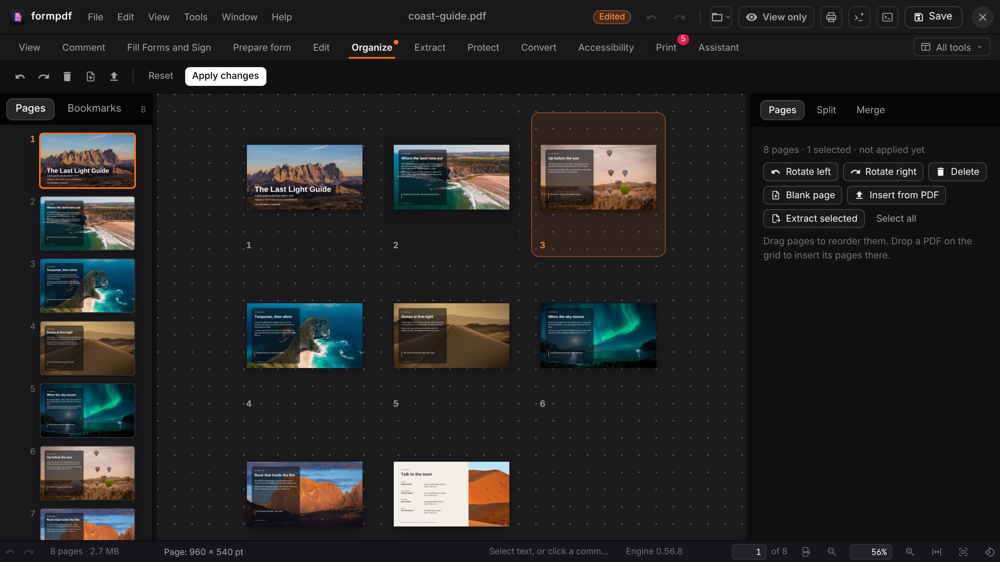
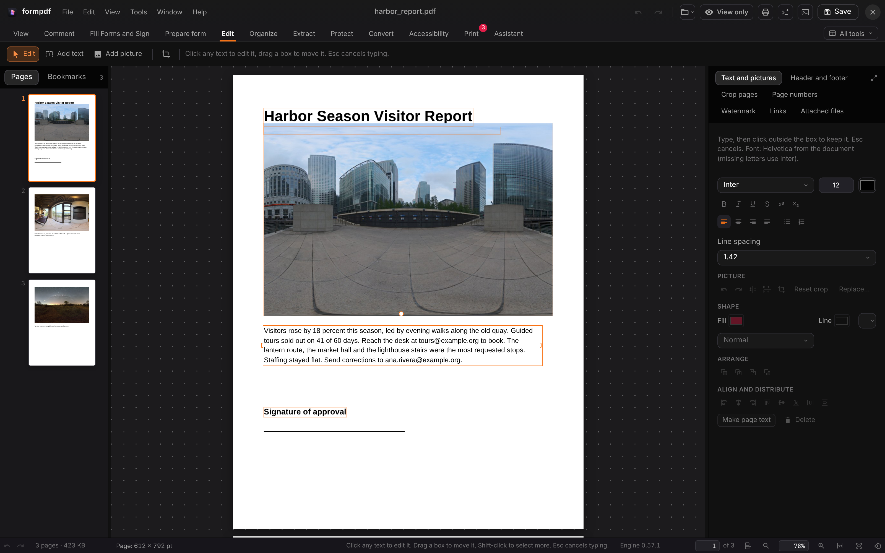
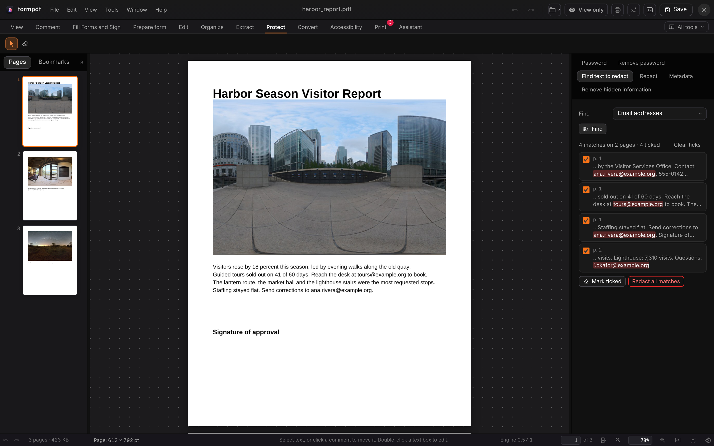
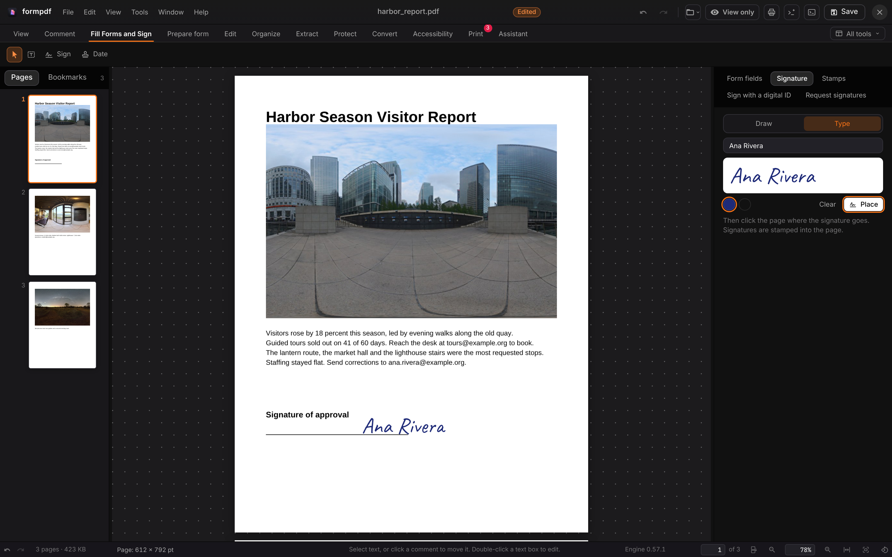
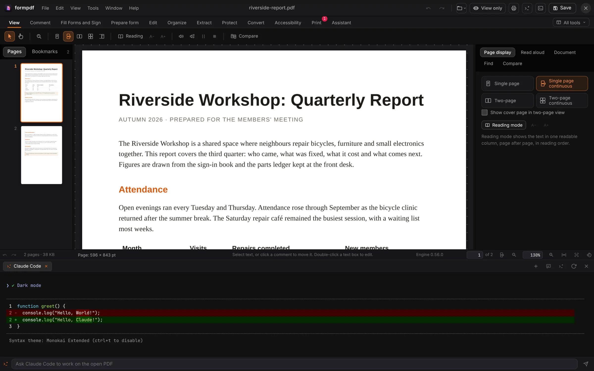

<p align="center">
  
</p>

<h1 align="center">FormPDF</h1>

<p align="center">
  <b>PDF editing; the PDF editor of the Form family.</b><br>
  In-place text editing, redaction, OCR, signing and forms, with an agent dock,<br>
  in one window on your computer. Your files never leave it. No account.
</p>

<p align="center">
  
  
  
  
  
  
</p>

<p align="center">
  <a href="https://formpdf.formai.studio/"><b>Download FormPDF on formai.studio</b></a> ·
  <a href="#run-it-from-source">Run it from source</a> ·
  <a href="#the-form-family">All Form apps</a>
</p>

<br>

<p align="center">
  
  <br>
  <sub>Organize an 8-page PDF: reorder, rotate, delete, insert, split and merge pages in one grid.</sub>
</p>

<p align="center">
  <a href="#features">Features</a> · <a href="#everything-in-the-box">In the box</a> · <a href="#built-for-agents">Agents</a> · <a href="#under-the-hood">Under the hood</a> · <a href="#download">Download</a> · <a href="#run-it-from-source">Run from source</a> · <a href="#the-form-family">Form family</a>
</p>

<table>
  <tr>
    <td width="25%" valign="top"><h3>Edit in place</h3>Change the text a PDF already has, in its own font where possible, and move, crop or replace its pictures.</td>
    <td width="25%" valign="top"><h3>Redact for real</h3>Find text or patterns and the content under each box is removed, not just covered. The rest stays selectable text.</td>
    <td width="25%" valign="top"><h3>Local only</h3>Files, OCR and signing stay on this computer, and Preferences lists every network connection. None leave it.</td>
    <td width="25%" valign="top"><h3>Agent-ready</h3>The same engine from the window, the command line and an MCP server, with the whole agent turn undoable at once.</td>
  </tr>
</table>

## Features

<table>
  <tr>
    <td width="50%" valign="top">
      <br><sub>Edit: a paragraph of a visitor report selected for editing.</sub>
      <h3>Edit text and pictures</h3>Click any text to retype it with font, size, style, alignment and lists. Pictures can be moved, cropped, flipped and replaced.
    </td>
    <td width="50%" valign="top">
      <br><sub>Protect: four email addresses found on two pages, all ticked.</sub>
      <h3>Find and redact</h3>Search for words, phrases or email addresses and tick the matches. Apply removes the content under each box.
    </td>
  </tr>
  <tr>
    <td width="50%" valign="top">
      <br><sub>Fill Forms and Sign: a typed signature on the approval line.</sub>
      <h3>Fill and sign</h3>Draw or type a signature and stamp it on the page. Or sign with a digital ID and check every signature in plain sentences.
    </td>
    <td width="50%" valign="top">
      <br><sub>Agent dock: a Claude Code terminal under the open PDF.</sub>
      <h3>Agents in the window</h3>Ctrl+J opens real terminals already connected to FormPDF's tools, plus a Chat tab that answers about the open PDF.
    </td>
  </tr>
</table>

## Everything in the box

<table>
  <tr>
    <td width="33%" valign="top"><h4>Work on the page</h4>View · Comment · Fill Forms and Sign · Prepare form · Edit · Organize · Extract · Protect · Convert · Accessibility · Print · Assistant</td>
    <td width="33%" valign="top"><h4>Protect and convert</h4>Passwords and permissions · Find and redact · Metadata · OCR on this computer · Word · PowerPoint · Excel · HTML · RTF · Compress · PDF/A · PDF/X-4</td>
    <td width="33%" valign="top"><h4>Formats</h4>Opens: PDF, PNG, JPG, GIF, WEBP, TIFF, DOCX, PPTX, XLSX (Office files through your LibreOffice) · Saves: PDF, plus text, tables, pictures and the exports above</td>
  </tr>
</table>

## Built for agents

83 PDF actions sit in one registry; the window, the command line and the MCP server call the same ones.

```sh
./formpdf run actions                                          # list every action
./formpdf run page_numbers report.pdf --format "Page {n} of {total}"   # a job without the window
./formpdf cli list                                             # every window command
./formpdf mcp                                                  # MCP server on stdio for Claude Code, Codex and Cursor
```

`.mcp.json`, `.codex/config.toml` and `.cursor/mcp.json` are already wired in this repo. With the engine running, Claude Code can also use `claude mcp add --transport http formpdf http://127.0.0.1:8198/mcp`. Ctrl+J (Cmd+J on a Mac) opens an agent dock with real terminals. See [`AGENTS.md`](AGENTS.md).

## Under the hood

- **Engine:** a FastAPI service in `backend/` does the PDF work, so the window, CLI and agents share one code path.
- **Window:** a vanilla TypeScript and Vite app in `frontend/`, with every menu item and shortcut a single command in one catalogue.
- **Desktop:** a Tauri shell in `src-tauri/` wraps the frozen engine as a sidecar.
- **Local data:** everything stays in `~/Formpdf`; override it with `FORMPDF_DATA_DIR`.
- **Tested:** 61 backend tests in `backend/tests`, run in CI.

## Download

**Get the app:** download FormPDF from [formai.studio](https://formpdf.formai.studio/). That is the easiest way to install it.

**Keep it updated:** [FormPortal](https://github.com/nodemode-dev/formportal) installs, updates and rolls back every Form app from the same signed catalogue.

| Platform | Builds |
|---|---|
| macOS | Apple silicon |
| Windows | x64 |
| Linux | x64 |

All FormPDF builds are compiled and released from [`nodemode-dev/formcompiler`](https://github.com/nodemode-dev/formcompiler/releases?q=formpdf-v&expanded=true), not from this repo. This repo holds the source.

## Run it from source

Prefer it in your browser, or want to contribute? Run the web UI straight from this repo.

**Requires:** Python 3.12+ and Node 20.19+ or 22.12+ (`./formpdf doctor` checks them).

```sh
git clone git@github.com:nodemode-dev/formpdf.git
cd formpdf
./formpdf install   # backend venv and frontend packages
./formpdf           # web UI at http://localhost:5198
```

`./formpdf desktop dev` opens the desktop window instead. On Windows use `formpdf.bat install` then `formpdf.bat`. The engine listens on http://127.0.0.1:8198 (`FORMPDF_PORT` moves it).

| Variable | Purpose |
|---|---|
| `FORMPDF_DATA_DIR` | Where working copies, exports and settings live (default `~/Formpdf`) |
| `FORMPDF_NO_OCR` | Set to `1` before `./formpdf install` to leave out OCR (about 150 MB) |

> [!IMPORTANT]
> **Status:** pre-release. Gaps include hosted sharing, form JavaScript beyond the standard AcroForm functions and print production (CMYK, flattening). See [`docs/PARITY.md`](docs/PARITY.md).

**Contributing:** branch from `main`, keep changes to source here, and leave packaging and releases to FormCompiler. See [`CLAUDE.md`](CLAUDE.md) and [`AGENTS.md`](AGENTS.md).

## Repository

| Path | What it is |
|---|---|
| `backend/` | FastAPI engine: PDF services, `/api/pdf`, live channel, MCP server |
| `frontend/` | Vanilla TypeScript and Vite app: Home, the PDF workbench, styles |
| `setup/` | Install, boot, build, freeze, doctor, run, MCP stdio and agent scripts |
| `src-tauri/` | Desktop shell and the engine sidecar |
| `docs/` | [`MANUAL.md`](docs/MANUAL.md), [`PARITY.md`](docs/PARITY.md), plug-in examples |

## The Form family

FormPDF is one of the **Form apps**: native creative tools that install, update and roll back through FormPortal and can all be driven by agents.

| | App | What it's for | Download | Code |
|:-:|---|---|---|---|
|  | **form.md** | Documents, databases and realtime editing together | [formai.studio](https://formmd.formai.studio/) | [GitHub](https://github.com/nodemode-dev/form.md) |
|  | **FormAT** | Chat and agent workspace on your key | [formai.studio](https://format.formai.studio/) | [GitHub](https://github.com/nodemode-dev/format) |
|  | **FormCAD** | Drafting, parametric parts and NURBS surfaces | | [GitHub](https://github.com/nodemode-dev/formCAD) |
|  | **FormCel** | Spreadsheets agents can read and edit | [formai.studio](https://formcel.formai.studio/) | [GitHub](https://github.com/nodemode-dev/formcel) |
|  | **FormCraft** | Generate images, video, audio, 3D and worlds | | [GitHub](https://github.com/nodemode-dev/formcraft) |
|  | **FormCut** | Multi-track video editing with no upload | [formai.studio](https://formcut.formai.studio/) | [GitHub](https://github.com/nodemode-dev/formcut) |
|  | **FormDAM** | Photo library and asset manager | [formai.studio](https://formdam.formai.studio/) | [GitHub](https://github.com/nodemode-dev/formDAM) |
|  | **FormDeck** | Presentations and pitch decks | [formai.studio](https://formdeck.formai.studio/) | [GitHub](https://github.com/nodemode-dev/formdeck) |
|  | **FormDesign** | Page layout for print and the web | [formai.studio](https://formdesign.formai.studio/) | [GitHub](https://github.com/nodemode-dev/formdesign) |
|  | **FormEncoder** | Media encoding queue with presets | [formai.studio](https://formencoder.formai.studio/) | [GitHub](https://github.com/nodemode-dev/formencoder) |
|  | **FormFabric** | Sewing patterns draped with cloth simulation | | [GitHub](https://github.com/nodemode-dev/formfabric) |
|  | **FormLit** | Photo library and raw development | [formai.studio](https://formlit.formai.studio/) | [GitHub](https://github.com/nodemode-dev/formlit) |
|  | **FormMorpheus** | Frame-by-frame and performed animation | | [GitHub](https://github.com/nodemode-dev/formmorpheus) |
|  | **FormNET** | See what your computer sends online | | [GitHub](https://github.com/nodemode-dev/formNET) |
|  | **FormPath** | Vector illustration with artboards and type | [formai.studio](https://formpath.formai.studio/) | [GitHub](https://github.com/nodemode-dev/formpath) |
|  | **FormPDF** | Edit, redact, sign and fill PDFs | [formai.studio](https://formpdf.formai.studio/) | [GitHub](https://github.com/nodemode-dev/formpdf) |
|  | **FormPromo** | Promo films from your own media | [formai.studio](https://formpromo.formai.studio/) | [GitHub](https://github.com/nodemode-dev/formpromo) |
|  | **FormRef** | Reference boards for creative work | [formai.studio](https://formref.formai.studio/) | [GitHub](https://github.com/nodemode-dev/formref) |
|  | **FormRig** | Rig, skin and retarget any mesh | | [GitHub](https://github.com/nodemode-dev/formrig) |
|  | **FormSculpt** | 3D sculpting, remeshing and painting | [formai.studio](https://formsculpt.formai.studio/) | [GitHub](https://github.com/nodemode-dev/formsculpt) |
|  | **FormSurface** | Texture painting with PBR export | [formai.studio](https://formsurface.formai.studio/) | [GitHub](https://github.com/nodemode-dev/formsurface) |
|  | **FormTools** | Viewers, batch tools and file utilities | | [GitHub](https://github.com/nodemode-dev/formtools) |
|  | **FormTxt** | Word processing with .docx round trips | [formai.studio](https://formtxt.formai.studio/) | [GitHub](https://github.com/nodemode-dev/formtxt) |
|  | **FormVFX** | Motion graphics and VFX compositing | [formai.studio](https://formvfx.formai.studio/) | [GitHub](https://github.com/nodemode-dev/formvfx) |
|  | **FormVis** | Layered image editing with local AI | [formai.studio](https://formvis.formai.studio/) | [GitHub](https://github.com/nodemode-dev/formvis) |
|  | **FormWav** | Multitrack audio editing and mixing | [formai.studio](https://formwav.formai.studio/) | [GitHub](https://github.com/nodemode-dev/formwav) |
|  | **FormWeb** | Visual website building with a CMS | [formai.studio](https://formweb.formai.studio/) | [GitHub](https://github.com/nodemode-dev/formweb) |
|  | **FormPortal** | Install, update and roll back Form apps | [formai.studio](https://formportal.formai.studio/) | [GitHub](https://github.com/nodemode-dev/formportal) |
|  | **FormTray** | One dock icon for every app | [formai.studio](https://formtray.formai.studio/) | [GitHub](https://github.com/nodemode-dev/formtray) |
|  | **FormMCP** | One MCP connection to the family | [formai.studio](https://formmcp.formai.studio/) | [GitHub](https://github.com/nodemode-dev/formMCP) |
|  | **FormSkills** | Every app's agent skills in one place | [formai.studio](https://formskill.formai.studio/) | [GitHub](https://github.com/nodemode-dev/formskills) |
|  | **FormBench** | Parity, testing and rankings for the family | [formai.studio](https://formranker.formai.studio/) | [GitHub](https://github.com/nodemode-dev/formbench) |
|  | **FormSlot** | Codebase memory for coding agents | | [GitHub](https://github.com/nodemode-dev/formslot) |
|  | **SubForm** | Workbench for parallel Claude Code agents | | [GitHub](https://github.com/nodemode-dev/subform) |
|  | **FormCompiler** | Builds, signs and releases every app | [formai.studio](https://formcompiler.formai.studio/) | [GitHub](https://github.com/nodemode-dev/formcompiler) |
|  | **FormPipe** | Release pipeline and update feeds | | [GitHub](https://github.com/nodemode-dev/formpipe) |

<br>

---

## Maintainers

| Maintainer | Role |
|---|---|
| [@nodemode-ai](https://github.com/nodemode-ai) | Owner |
| [@gbarnai](https://github.com/gbarnai) | Co-owner |

Code owners are set in [`.github/CODEOWNERS`](.github/CODEOWNERS).

## License

FormPDF is licensed under the Apache License 2.0 ([`LICENSE`](LICENSE), SPDX `Apache-2.0`). Copyright 2026 NodeAgentc, Inc. Third-party notices: [`NOTICE.md`](NOTICE.md).

<sub>Screenshot content: CC0 photos from Poly Haven. Hero: a sample travel guide made for the Form family.</sub>

<sub>Adobe, Acrobat, Microsoft, Word and PowerPoint are trademarks of their respective owners. FormPDF is an independent project and is not affiliated with or endorsed by them.</sub>
